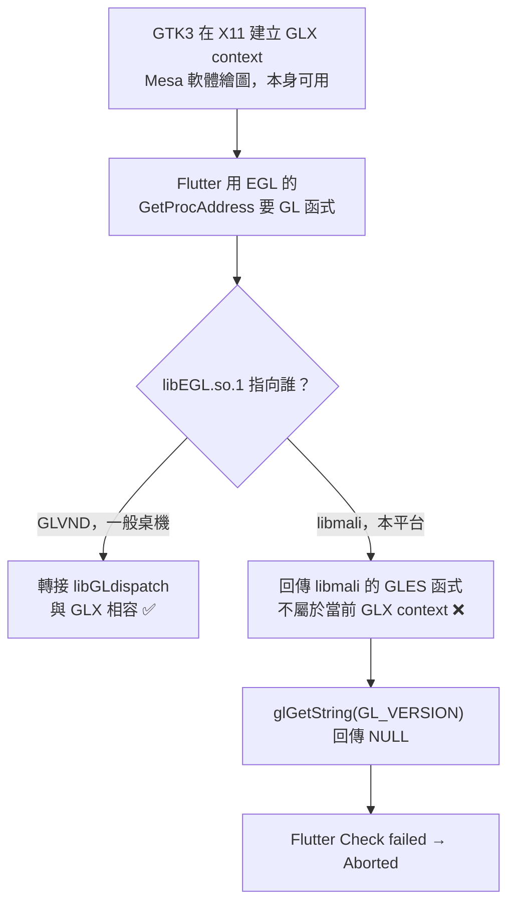
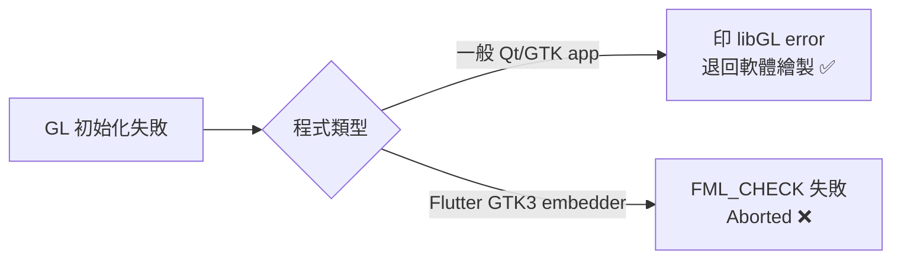

# RK3562 Flutter App 啟動失敗：EGL 與 GLX 不匹配

> [!NOTE] 這篇在講什麼
> 板子上啟動 RustDesk 時，程式直接當掉並印出 `Check failed: gl_version_string`。
> 這篇用白話說明原因，並提供 5 分鐘的診斷步驟與修法。
> 本文為淺顯整理版，完整技術細節見專案根目錄的 `RUSTDESK_GL_STARTUP_FAILURE.md`。

**適用平台**：RK3562 EVB2（Rockchip Linux 6.1 + Debian 12 arm64）
**適用軟體**：RustDesk 1.5.0 aarch64（內含 Flutter 3.5.4 Linux GTK3 embedder）
**狀態**：根因已確認，修法已在板端實測並通過映像驗證（2026-10-06）

---

## 1. 先看結論

### 1.1 一句話說明

> [!IMPORTANT] 核心問題
> GTK3 交給 Flutter 的是 **GLX** 類型的繪圖連線。
> 但 Flutter 只用 **EGL** 的詢問介面去要繪圖函式。
> 本平台的 EGL 被廠商的 libmali 佔用，它不認識 GLX。
> 所以 Flutter 拿到的函式指標是錯的，`glGetString` 回傳空值，程式直接中止。

### 1.2 用打電話問路來比喻

把「取得畫圖工具」想成打電話問路：

- Flutter 手上只有一支 **EGL 的電話**，它用這支電話問「畫圖工具在哪」。
- 一般桌機的 EGL 是 **GLVND 總機**。總機會自動轉接到正確分機（`libGLdispatch`）。
- 本平台的 EGL 被換成 **libmali 專線**。專線只認自己家的分機。
- Flutter 問的是 GLX 的東西 → 專線給空號 → Flutter 放棄（abort）。

### 1.3 三個關鍵結論

| # | 結論 |
| --- | --- |
| 1 | **不是 Mesa、DRI driver、kernel 或權限問題**。`glxinfo -B` 在任何設定下都能拿到 `OpenGL 4.5 / direct rendering: Yes` |
| 2 | **不是 RK3562 獨有**。只要是「廠商自帶 EGL ＋ GTK3 走 X11 ＋ 官方 Flutter GTK3 embedder」的組合就會中 |
| 3 | **修法很便宜**。只針對該 app 讓 GLVND 的 libEGL 優先（`LD_LIBRARY_PATH`），不動系統設定、不損失硬體 GLES |

---

## 2. 症狀

```text
Cannot load libcuda.so.1                       ← 無害（NVIDIA 探測）
dbind-WARNING AT-SPI ...                       ← 無害（沒有 a11y bus）
libGL error: glx: failed to create dri3 screen
libGL error: failed to load driver: rockchip   ← 無害（Mesa fallback 訊息）
libGL error: glx: failed to create dri2 screen
libGL error: failed to load driver: rockchip
[FATAL:flutter/shell/gpu/gpu_surface_gl_delegate.cc(76)]
    Check failed: gl_version_string. The GL proc resolver's glGetString(GL_VERSION) failed
Aborted
```

> [!WARNING] 最容易誤判的地方
> **只有 Flutter app 會中止**。同樣那 4 行 `libGL error`，在 `glxinfo`、`glxgears` 上只印警告，程式照常運作。
> 這 4 行不是肇因，詳見第 5 節。

---

## 3. 先認識這條鏈上的角色

| 名詞 | 白話解釋 | 在本平台的實作 |
| --- | --- | --- |
| **X11 / Wayland** | 兩種圖形視窗系統 | 本案例使用 X11 |
| **GLX** | X11 專用的 desktop GL 入口介面 | `libGL.so.1` + `libGLX_mesa.so.0` |
| **EGL** | 跨視窗系統的 GL/GLES 入口介面 | `libEGL.so.1` |
| **GLVND** | 「廠商中立」的分派層，等同總機 | 一般桌機的標準，本平台被 libmali 取代 |
| **Mesa** | 提供軟體繪圖（llvmpipe）與 DRI driver 載入 | 版本 `22.3.6-1+deb12u2` |
| **libmali** | Rockchip 的 Mali GPU 使用者空間。**只有 EGL / GLES，沒有 desktop GL** | `libmali-bifrost-g52-g24p0-x11-wayland-gbm 1.9-1` |
| **libepoxy** | GTK3 與 Flutter 呼叫 GL 的包裝層，用 soname 找 `libEGL.so.1` | `libepoxy.so.0` |
| **GTK3** | 視窗工具庫。X11 後端**只走 GLX**，原始碼內沒有 `eglCreateContext` | `libgtk-3.so.0.2406.32` |
| **Flutter embedder** | Flutter app 的執行載體，用 EGL 介面解析 GL 函式 | `libflutter_linux_gtk.so`（3.5.4） |

### 3.1 故障流程



### 3.2 決定性證據

| # | 事實 | 驗證方式 |
| --- | --- | --- |
| 1 | Flutter 唯一的 proc-address resolver 是 EGL 的 | `nm -D -u libflutter_linux_gtk.so \| grep -iE 'procaddress\|glx\|egl'` → 只有 `U epoxy_eglGetProcAddress` |
| 2 | GTK3 沒有 export proc-address getter | `readelf --dyn-syms libgtk-3.so.0 \| grep gdk_gl_context_` → 只有 `make_current` / `realize` |
| 3 | GTK3 X11 沒有 EGL context 路徑 | `strings libgtk-3.so.0 \| grep -c 'eglCreateContext'` → **0** |
| 4 | libepoxy 以 soname 找 EGL | `strings libepoxy.so.0.0.0 \| grep '^lib.*\.so'` → `libEGL.so.1`、`libGL.so.1` 等 |
| 5 | `libEGL.so.1` 被 libmali 佔用 | `/etc/ld.so.conf.d/00-aarch64-mali.conf` 指向 `/usr/lib/aarch64-linux-gnu/mali` |
| 6 | libmali 的 libEGL 只是轉發 shim | 只有 5928 bytes，字串只有 `libmali.so.1` / `libmali-hook.so.1` |
| 7 | 沒有 EGL context 時 `glGetString` 為 NULL | 板端 `GDK_GL=disable` 對照實驗：GLArea 起不來時**不 abort** |

---

## 4. 為什麼各程式反應不同

Flutter 把 GL context 當成**必要條件**：`GPUSurfaceGLDelegate` 開頭就呼叫 `glGetString(GL_VERSION)` 並做 `FML_CHECK`。
其他程式（Qt、GTK 自繪）GL 失敗時會退回軟體繪製，所以只是印警告。



### 4.1 那 4 行 libGL error 是無害的

`libGL error: failed to load driver: rockchip` 是 Mesa 的**正常 fallback 訊息**。
Mesa 先嘗試硬體 DRI driver（由 kernel DRM 名稱推導為 `rockchip`），失敗後改用軟體繪圖（llvmpipe）。
`glxinfo -B` 印完同樣 4 行後，照樣回報：

```text
direct rendering: Yes
OpenGL renderer string: llvmpipe (LLVM 15.0.6, 128 bits)
OpenGL version string: 4.5 (Compatibility Profile) Mesa 22.3.6
```

> [!NOTE] 補充
> 本核心 `# CONFIG_DRM_PANFROST is not set`、`# CONFIG_DRM_LIMA is not set`，只有 Rockchip 自家的 `CONFIG_MALI400/450=y`。
> 所以 Mesa 的 kmsro/panfrost 路徑本來就不可能成功。但這**不是** RustDesk 啟動失敗的原因。

---

## 5. 為什麼一般桌機不會壞

一般 Linux 桌機的 `libEGL.so.1` **一律是 GLVND**。

| 平台 | `libEGL.so.1` 的身分 | `eglGetProcAddress("glGetString")` 的行為 | 結果 |
| --- | --- | --- | --- |
| x86 / 一般桌機 | GLVND | 沒有當前 EGL display → fallback 到 `libGLdispatch`，與 `libGL` 共用同一份 dispatch | ✅ 回傳可用指標 |
| 本平台 | libmali shim | 直接回傳 libmali 的 GLES 函式，libmali 沒有 GLX dispatch | ❌ current context 是 GLX → NULL |

**這個說法可以在映像上直接驗證（不是推論）：**

```bash
# GLVND 的 libEGL 依賴 libGLdispatch
$ objdump -p /usr/lib/aarch64-linux-gnu/libEGL.so.1.1.0 | grep NEEDED
  NEEDED  libGLdispatch.so.0
  NEEDED  libc.so.6
$ nm -D -u /usr/lib/aarch64-linux-gnu/libEGL.so.1.1.0 | grep -i dispatch
  U __glDispatchGetProcAddress

# libGL 用的是同一套 dispatch
$ objdump -p /usr/lib/aarch64-linux-gnu/libGL.so.1.7.0 | grep NEEDED
  NEEDED  libGLdispatch.so.0
  NEEDED  libGLX.so.0
```

`libEGL` 與 `libGL` 共用 `libGLdispatch`。
所以在 GLVND 環境下，「用 EGL 的 GetProcAddress 取 GLX context 的函式」是合法可行的。
Flutter 這種寫法在桌機上一直沒問題，就是這個原因。

---

## 6. 這不是 RK3562 獨有的問題

觸發條件是三個要素的**組合**：

1. `libEGL.so.1` 解析到廠商自帶（非 GLVND）的 EGL。
2. app 跑在 X11 session（GTK3 走 GLX）。
3. app 使用官方 Flutter Linux GTK3 embedder。

三者同時成立才會 abort。任一項不成立就不會發生：

- 非廠商 EGL → 正常。
- Wayland session → GTK3 走 EGL，與廠商 EGL 相符。
- 非 GTK embedder（flutter-pi、ivi-homescreen）→ 直接走 EGL。

### 6.1 本 SDK 內所有 RK SoC 都一樣

`debian/overlay/etc/init.d/rockchip.sh` 對每個 SoC 安裝同一套 libmali，並靠同一個 `00-aarch64-mali.conf` 讓它優先。

| `rockchip.sh` 分支 | 安裝的 libmali |
| --- | --- |
| `rk3562`、`rk3566/rk3568`、`rk3576`、`rk3588/rk3588s` | `libmali-*<MALI>*-x11-wayland-gbm*.deb` |
| `rk3288`、`rk3399/rk3399pro`、`rk3328/rk3528`、`rk3326/px30`、`rk3128/rk3036` | `libmali-*<MALI>*-x11*.deb` |

同樣的 rootfs 機制套在 RK3566/3568/3576/3588 上，跑同一個 Flutter app、同一個 X11 session，就會得到**一模一樣的 abort**。

### 6.2 更廣的 embedded 場景

| 類型 | 會不會中 | 說明 |
| --- | --- | --- |
| ARM SoC ＋ 廠商 Mali blob（Rockchip / Allwinner / Amlogic） | **會** | 本文的機制 |
| ARM SoC ＋ Vivante（NXP i.MX）、PowerVR（TI）等廠商 EGL | **很可能會** | 只要該 EGL 不是 GLVND 且比系統 `libEGL.so.1` 優先 |
| 樹莓派（Mesa 為主） | 通常不會 | `libEGL` 是 Mesa/GLVND，沒有廠商 shim 搶 soname |
| Yocto/Buildroot ＋ 非 GTK embedder | 不會 | 不經 GTK3/X11/GLX，直接走 EGL |
| 任何平台 ＋ Wayland session | 不會（但另有問題） | GTK3 走 EGL；不過 RustDesk 在 Wayland 下螢幕擷取需 portal |
| x86 / arm64 桌面發行版 | 不會 | `libEGL.so.1` 一律是 GLVND |

> [!TIP] 責任歸屬
> Flutter 官方的寫法在 GLVND 世界是合法的，且此版 embedder 沒有軟體 renderer 可退回。
> 廠商 BSP 用 `ld.so.conf` 搶走 `libEGL.so.1` 的 soname，破壞了 GLVND 的一致性。
> 對應用／系統整合者最務實的做法，是在 app 啟動時把 GLVND 的 libEGL 放回優先。

---

## 7. 五分鐘診斷流程

### 步驟

1. 確認 GL 本身是否正常。執行 `glxinfo -B`。
2. 看 embedder 用哪個 proc resolver。
3. 看 `libEGL.so.1` 實際指向誰。
4. 用 `LD_LIBRARY_PATH` 做 30 秒驗證，不用重燒。

### 可直接複製的指令

```sh
# ① Mesa/GLX 是否正常（重點：要有 OpenGL version + direct rendering: Yes）
glxinfo -B 2>&1 | grep -E "direct rendering|OpenGL version|renderer"

# ② 這個 embedder 用哪個 proc resolver（重點：只有 epoxy_eglGetProcAddress）
nm -D -u /path/to/app/lib/libflutter_linux_gtk.so | grep -iE 'procaddress|glx|egl'

# ③ libEGL.so.1 是否被廠商 shim 搶走
cat /etc/ld.so.conf.d/*mali*.conf 2>/dev/null
ldd /path/to/app/your-app 2>/dev/null | grep -i egl
ls -l /usr/lib/*/mali/libEGL.so.1 2>/dev/null

# ④ 30 秒驗證修法（不用重燒）
LD_LIBRARY_PATH=/usr/lib/aarch64-linux-gnu your-app
```

| 檢查結果 | 判斷 |
| --- | --- |
| `glxinfo` 沒有 OpenGL version | GL 真的壞了，往 driver / 權限查（本例不是） |
| embedder 只有 `epoxy_eglGetProcAddress` 且 libEGL 指向廠商 shim | 命中本文問題 |

---

## 8. 解決方案

| 方案 | 做法 | 優點 | 缺點 | 適用 |
| --- | --- | --- | --- | --- |
| **A. 每個 app 一個 wrapper** | 在 `/usr/bin` 放 wrapper：設好 `LD_LIBRARY_PATH` 後 `exec` 真正的執行檔 | 零副作用、不動系統、可逐 app 控管 | 每個 Flutter app 都要做一次 | ⭐ 本案例採用 |
| **B. 系統全域 `LD_LIBRARY_PATH`** | 寫進 `/etc/environment` 或 systemd `DefaultEnvironment` | 一次解決所有 app | 所有程式的 libEGL/GLESv2 都變 Mesa，**libmali 硬體 GLES 失效** | 不在意硬體 GLES 時 |
| **C. 改 `ld.so.conf` 排序** | 把 `00-aarch64-mali.conf` 改名為 `99-…` | 同 B，且不需環境變數 | 同 B | 同上 |
| **D. 自製 `libEGL` shim** | 一般 EGL 呼叫轉發 libmali；`eglGetProcAddress` 依當前 context 類型分流到 EGL 或 GLX | 一勞永逸、**保留硬體 GLES** | 需要維護一個 shim | 多個 Flutter app 時值得做 |
| **E. 換 embedder 或換 session** | 改用 `ivi-homescreen` / `flutter-pi`，或整體走 Wayland | 可直接吃硬體 GLES | 改動大；Wayland 下 RustDesk 螢幕擷取另有問題 | 長期架構調整 |

### 為什麼方案 A 有效

`LD_LIBRARY_PATH` 的搜尋優先序**高於** `ld.so.conf` 與 `ld.so.cache`：

```text
dlopen("libEGL.so.1") 的搜尋順序
  ① DT_RPATH
  ② LD_LIBRARY_PATH        ← 把 /usr/lib/aarch64-linux-gnu 放這裡
  ③ DT_RUNPATH
  ④ ld.so.cache / ld.so.conf  ← mali 目錄原本在這邊勝出
  ⑤ 預設目錄
```

於是 `libEGL.so.1` 解析到 **GLVND 版**（`libEGL.so.1.1.0`）。
`eglGetProcAddress` 就能 fallback 到 `libGLdispatch`，與 GLX context 相容。

---

## 9. 本專案已採用的修法

### 9.1 wrapper 內容（已寫入 `debian/mk-rootfs-bookworm.sh`）

`/usr/bin/rustdesk` 由 symlink 改成 wrapper：

```sh
#!/bin/sh
# Flutter 的 GL proc resolver 走 EGL (epoxy_eglGetProcAddress)，但 GTK3 在 X11 給的是
# GLX context。若 libEGL.so.1 解析到 libmali 的 shim，取回的 GL 進入點不屬於當前的
# GLX context，glGetString(GL_VERSION) 會回 NULL 並讓 Flutter abort。
# 讓 GLVND 的 libEGL 優先，eglGetProcAddress 就會走 libGLdispatch，與 GLX 相容。
export LD_LIBRARY_PATH="/usr/lib/aarch64-linux-gnu${LD_LIBRARY_PATH:+:$LD_LIBRARY_PATH}"
exec /usr/share/rustdesk/rustdesk "$@"
```

覆蓋範圍：桌面捷徑（`Exec=rustdesk` 走 `PATH`）、終端機、`rustdesk.service`（其 spawn 的 GUI 子程序會繼承環境）。

> [!CAUTION] 兩個實作陷阱（都踩過）
> 1. `mk-rootfs-bookworm.sh` 用**未加引號的 heredoc** 把指令餵進 chroot。
>    所以 wrapper 內的 `$@`、`${LD_LIBRARY_PATH:+...}` 必須寫成 `\$`。
>    否則會被 **host 端**先展開成空字串，產生 `exec ... ""`。
> 2. `cat > /usr/bin/rustdesk` 之前**必須先 `rm -f /usr/bin/rustdesk`**。
>    它是 dpkg postinst 建立的 symlink，直接寫入會**跟著 symlink 把真正的二進位覆蓋掉**。

### 9.2 驗證結果

```text
$ LD_LIBRARY_PATH=/usr/lib/aarch64-linux-gnu rustdesk     # 板端實測
→ ✅ 視窗正常出現

$ ./build.sh debian && ./build.sh updateimg               # 編譯
→ EXIT=0

$ bash analysis/rk3562-rustdesk-wayland-locale/verify-built-rootfs.sh
→ 38 OK / 0 WARN / 0 FAIL

$ debugfs -R 'cat /usr/bin/rustdesk' debian/linaro-rootfs.img
→ wrapper 內容正確（含 LD_LIBRARY_PATH）
$ debugfs -R 'stat /usr/share/rustdesk/rustdesk' debian/linaro-rootfs.img
→ Size: 50656  ← 真正的二進位完好，沒被覆蓋
```

產物：`debian/linaro-rootfs.img`、`output/firmware/update.img`。

### 9.3 修法為什麼沒有副作用

| 疑慮 | 說明 |
| --- | --- |
| 會不會影響其他程式的硬體 GLES？ | 不會。`LD_LIBRARY_PATH` 只作用於 RustDesk 這條 process tree，系統 `ld.so.conf` 未動 |
| 會不會讓 RustDesk 失去硬體加速？ | 不會損失。RustDesk 的 UI 走 GTK3/GLX，本平台 GLX 本來就只有軟體路徑（llvmpipe） |
| 遠端畫面擷取會不會受影響？ | 不會。擷取走 X11 `XGetImage`，與 GL 無關 |
| 之後換成有硬體 GL 的環境怎麼辦？ | 把 wrapper 換回 symlink 即可 |

---

## 10. 對其他 Flutter app 的影響

### 10.1 這個 image 沒有系統級 Flutter

`/usr/bin/flutter`、`/usr/bin/dart`、`/usr/share/flutter`、`flutter-pi` 全部不存在。
SDK 的 `debian/packages/arm64/` 也沒有 flutter/dart 套件。

**RustDesk 是自帶 engine 的型態**（Flutter Linux app 的標準打包方式）：

```text
/usr/share/rustdesk/
├── rustdesk                      50 KB    啟動器
├── lib/libflutter_linux_gtk.so   13.9 MB  ← Flutter 3.5.4 Linux (GTK3) embedder
├── lib/libapp.so                 13.6 MB  ← Dart AOT snapshot
├── lib/lib*_plugin.so                     ← plugins
└── data/icudtl.dat + flutter_assets/      ← version.json: flutter_hbb 1.5.0 (build 68)
```

### 10.2 掃描與量產 wrapper

只要是「官方 Linux GTK3 embedder ＋ X11」就會一樣。
因為 `libflutter_linux_gtk.so` 就是官方 embedder，`flutter build linux` 的產物都帶著它。

```sh
# 掃描整個 app bundle
sh analysis/rk3562-rustdesk-wayland-locale/flutter-app-gl-fix.sh scan debian/binary
#   ── Flutter app bundle ──  usr/share/rustdesk/lib
#   [會踩到] embedder import 了 epoxy_eglGetProcAddress（EGL proc-resolver）
#   啟動檔: usr/bin/rustdesk

# 幫別的 app 產生 wrapper
sudo sh analysis/rk3562-rustdesk-wayland-locale/flutter-app-gl-fix.sh wrap /opt/myapp/myapp myapp
```

---

## 11. 走過的死路（避免重蹈）

| 嘗試 | 結果 | 為什麼無效 |
| --- | --- | --- |
| `LIBGL_ALWAYS_SOFTWARE=1` | ❌ | 這是 Mesa 的變數，只改變 Mesa 選哪個 DRI 驅動；本問題在「誰提供 GL 函式指標」 |
| `MESA_LOADER_DRIVER_OVERRIDE=swrast` | ❌ | 同上 |
| `GALLIUM_DRIVER=llvmpipe`、`MESA_GL_VERSION_OVERRIDE=3.3` | ❌ | 同上 |
| `LIBGL_DRI3_DISABLE=1` | ❌ | 同上 |
| `LD_LIBRARY_PATH=…/mali` | ❌ | mali 目錄本來就已經在最前面，等於沒改 |
| `rustdesk --enable-software-rendering` | ❌ | 此版 GTK3 embedder 沒有對應的軟體 renderer 實作 |
| `GDK_GL=disable` | ⚠️ 不 abort，但 GLArea 起不來 | 只是繞過 GL，不是解法。可當「abort 來自 GL 路徑」的對照實驗 |
| 推論「缺 `CONFIG_DRM_PANFROST` 導致 DRI 載入失敗」 | ❌ | 那 4 行 `libGL error` 是無害 fallback；`glxinfo` 印同樣訊息仍拿到 OpenGL 4.5 |
| `nm` 找不到 `__driDriverGetExtensions` | ❌ 誤判 | megadriver 本來就只用 `__driDriverGetExtensions_<name>` |
| 以為 chroot 內 heredoc 用 TAB 沒關係 | ❌（另一件事） | heredoc 內用 TAB 會觸發 readline 補全、無聲吃掉指令 |

---

## 12. 移植到其他專案的檢查清單

- [ ] `glxinfo -B` 有 `OpenGL version` ＋ `direct rendering: Yes`？（先排除 GL 真的壞掉）
- [ ] `nm -D -u <app>/lib/libflutter_linux_gtk.so | grep -i procaddress` 是否只有 `epoxy_eglGetProcAddress`？
- [ ] `ldd <app> | grep -i egl` 指到哪個 `libEGL.so.1`？（GLVND 還是廠商 shim？）
- [ ] `cat /etc/ld.so.conf.d/*.conf` 有沒有把廠商 GPU 目錄排在最前面？
- [ ] 是 X11 還是 Wayland session？（Wayland 不會中）
- [ ] 先用 `LD_LIBRARY_PATH=/usr/lib/<triplet> <app>` 驗證，再決定要不要做成 wrapper
- [ ] 若 app 很多 → 考慮自製 libEGL shim（方案 D），避免系統全域切換而損失硬體 GLES

---

## 相關文件

- [[01-開發技術/嵌入式開發/平台/Rockchip/rk3399 DP 無聲問題]] — 同為 Rockchip 平台的顯示／音訊整合問題
- [[01-開發技術/電腦視覺與繪圖/改善說明_4K縮放繪圖鋸齒問題]] — 繪圖渲染相關問題的排查思路
- [[01-開發技術/嵌入式開發/Build系統/BuildRoot/使用 chroot 進入虛擬機的機制]] — heredoc 餵入 chroot 的行為
- [[01-開發技術/嵌入式開發/創建 Debian 套件]] — dpkg postinst symlink 與檔案覆蓋的關聯背景

## 原始出處

- 專案根目錄 `RUSTDESK_GL_STARTUP_FAILURE.md`（完整技術說明，含全部板端數據）
- `analysis/rk3562-rustdesk-wayland-locale/SUMMARY.md` §8（完整分析）、§9（Flutter 執行環境盤點）
- 決定性證據：`evidence/12-root-cause-egl-glx-mismatch.txt`、`evidence/14-fix-confirmed-on-board.txt`、`evidence/15-build-fix-verification.log`、`evidence/13-board-gl-diagnostic-v2.txt`
- 板端工具：`check-rustdesk-gl.sh`、`check-display-rustdesk-locale.sh`、`flutter-app-gl-fix.sh`、`verify-built-rootfs.sh`
- patch：`patches/0001-debian-mk-rootfs-bookworm-rustdesk-locale.patch`
