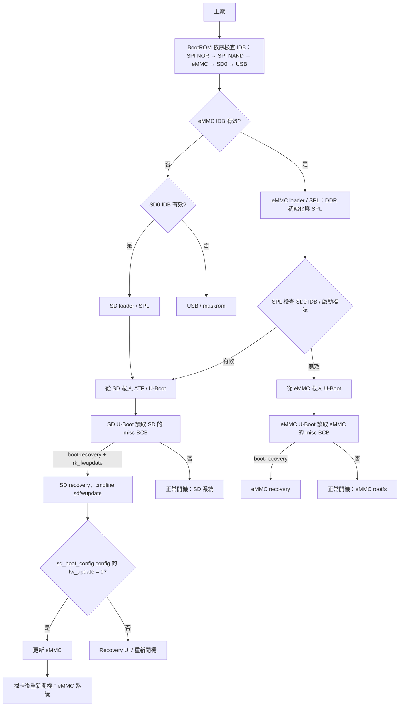

# RK3562 SD 更新機制與 BootROM 開機流程

> [!NOTE] 適用範圍
> RK3562 EVB2 DDR4 V10，Debian 12 BSP SDK `v1.2.0_20250620`。
> 流程與指令依此 BSP 版本整理，其他版本可能不同。

本文說明 SD 升級卡的選取方式、eMMC 區塊需求、一般開機與 SD 更新的差異，以及全量與單一分區更新流程。

**實測環境**：2026-10-28，UART `ttyUSB0`、1500000 8N1；記錄檔為 `output/console-ttyUSB0.log`。

## 1. 重點摘要

- SDDiskTool 製作的 SD 升級卡包含 loader/IDB、U-Boot、misc BCB、recovery 與 `sdupdate.img`。
- RK3562 BootROM 順序為 SPI NOR → SPI NAND → eMMC → SD0 → USB。若 eMMC 有效，BootROM 會先載入 eMMC loader/SPL。
- eMMC loader/SPL 會優先檢查 SD。SD 有有效 IDB 與啟動標誌時，後續從 SD 載入 U-Boot。
- SD U-Boot 讀取 SD 卡 misc 的 BCB。BCB 有 `boot-recovery` 與 `rk_fwupdate` 時，才進入 SD recovery 更新流程。
- Recovery 還會檢查 `sd_boot_config.config` 的 `fw_update=1`。缺少設定時，不會執行更新。
- 一般板子進入 SD 更新，第一階段依賴 eMMC loader 區（sector 64 的 IDB 與 SPL）。eMMC 的 `uboot` 分區、`misc` 與 `recovery` 不參與此更新路徑。

## 2. 名詞

| 名詞 | 說明 |
| --- | --- |
| BootROM | SoC 內部的 mask ROM，負責啟動初期的開機媒體選擇。 |
| IDB | ID Block，位於儲存裝置 sector 64。BootROM 用它判斷該介面是否有可開機 loader。 |
| Loader / SPL | `MiniLoaderAll.bin`，包含 DDR 初始化與 SPL，放在 eMMC 或 SD 的 sector 64。 |
| U-Boot | U-Boot proper，放在 eMMC 或 SD 的 `uboot` 分區。 |
| Recovery | `recovery.img`。SD 更新時由 SD 卡載入，不是 eMMC recovery。 |
| BCB | Android Bootloader Control Block，位於 `misc` 分區。SD 升級卡會寫入 `boot-recovery` 與 `recovery\n--rk_fwupdate\n`。 |
| SD 升級卡 | 由 SDDiskTool 製作，包含 IDB、U-Boot、misc BCB、recovery，資料分區存放 `sdupdate.img`。 |

## 3. RK3562 BootROM 順序

| 順序 | 介面 | 說明 |
| --- | --- | --- |
| 1 | SPI NOR (SFC) | 有有效 IDB 時載入。 |
| 2 | SPI NAND (SFC) | 有有效 IDB 時載入。 |
| 3 | eMMC | 有有效 IDB 時載入；一般板子會在此選中 eMMC。 |
| 4 | SD0 | eMMC 沒有有效 IDB 時才會繼續檢查。 |
| 5 | USB / maskrom | 前述媒體都無法啟動時進入 loader 模式。 |

BootROM 的判斷重點如下：

- BootROM 只檢查 sector 64 的 IDB，不讀 GPT 或檔案系統。
- BootROM 遇到第一個有效 IDB 就載入，不再嘗試後續介面。
- IDB 有效但 loader/SPL 損壞時，BootROM 不會自動改試下一個介面。
- 少數晶片支援透過 ADC key 或 strapping 指定儲存裝置。RK3562 應依官方順序表判斷；此 SDK 沒有提供修改 BootROM 順序的設定。

> [!IMPORTANT] eMMC 先於 SD0
> 若 eMMC sector 64 有有效 IDB，BootROM 會先執行 eMMC loader/SPL。
> SD 升級卡能否接手，接著取決於 SPL 對 SD 的優先判斷，而不是 BootROM 直接跳過 eMMC。

## 4. 開機與 SD 更新流程



各階段的執行位置如下：

- **BootROM**：位於 SoC 內部，只判斷各介面 sector 64 是否有有效 IDB。
- **eMMC loader/SPL**：位於 eMMC sector 64，負責 DDR 初始化、SPL 與 SD 優先判斷。
- **SD U-Boot**：從 SD 的 `uboot` 分區載入，並讀取 SD 卡 misc 的 BCB。
- **SD recovery**：從 SD 的 `recovery` 分區載入，讀取 `sd_boot_config.config`，再執行 `rkupdate` 寫入 eMMC。
- **eMMC U-Boot / rootfs**：SD 未被選中時，系統走原本的 eMMC 開機路徑。

## 5. 正常開機與 SD 更新的判斷點

| 階段 | 檢查內容 | 判斷結果 |
| --- | --- | --- |
| BootROM | 各介面 sector 64 的 IDB | 載入第一個有效 IDB；RK3562 的 eMMC 順序在 SD0 之前。 |
| SPL | SD 卡的 IDB / 啟動標誌 | SD 可開機時切到 SD，並從 SD 載入 U-Boot。 |
| U-Boot | 目前開機裝置的 misc BCB | `boot-recovery` 與 `rk_fwupdate` 會觸發 recovery 與 `sdfwupdate`。 |
| Recovery | cmdline `sdfwupdate` 與 SD 卡設定檔 | `fw_update=1` 時更新 eMMC；否則只進一般 recovery。 |

| SD 卡類型 | SD 卡內容 | 開機結果 |
| --- | --- | --- |
| 一般資料卡 | 沒有有效 IDB | SPL 不切到 SD，正常從 eMMC 開機。 |
| SD 啟動卡 | 有效 IDB，啟動標誌設為「啟動」 | 從 SD 開機，但不執行更新。 |
| SD 升級卡 | 有效 IDB、BCB 含 `boot-recovery` 與 `rk_fwupdate`、設定檔含 `fw_update=1` | 進入 recovery 並更新 eMMC。 |

## 6. eMMC 區塊需求

| eMMC 區域 | SD 更新是否需要 | 說明 |
| --- | --- | --- |
| Loader / IDB（sector 64 + SPL） | 若 BootROM 選中 eMMC，則需要 | 一般板子會先載入此處；損壞時無法透過該 loader 切到 SD。 |
| `uboot` 分區（`uboot.img`） | 不需要 | SD 可開機時，SPL 會從 SD 載入 U-Boot。 |
| `misc` 分區 | 不需要 | 更新流程使用 SD 卡上的 BCB。 |
| `recovery` 分區 | 不需要 | Recovery 從 SD 卡載入。 |
| `boot` / kernel | 不需要 | 這些是更新目標，不參與進入 recovery。 |
| `rootfs` / `oem` / `userdata` | 不需要 | 這些是更新目標；更新 `userdata` 會清除資料。 |
| `parameter` / GPT | partial 更新需要 | Full image 可重建分區表；partial image 只寫指定分區，因此需要有效 GPT。 |
| eMMC 可寫入性與容量 | 必要 | 唯讀、寫保護或容量不足都會導致更新失敗。 |

其他情況：

- eMMC 完全空白或 sector 64 沒有有效 IDB 時，BootROM 會繼續檢查 SD0，可使用 SD 卡自己的 loader 開機，適用於裸片升級。
- eMMC IDB 有效但 SPL 損壞時，BootROM 不會自動改試 SD；板子可能停在 loader/maskrom。
- eMMC `uboot` 分區損壞時，仍可能透過 SD 進行更新，因為 SPL 可從 SD 載入 U-Boot。但若 partial image 不含 `uboot`，更新後仍需原本的 eMMC U-Boot 正常，系統才能從 eMMC 開機。

## 7. SD 升級卡必備內容

| 項目 | 要求 |
| --- | --- |
| IDB | sector 64 有效 loader/IDB，由 SDDiskTool 寫入。 |
| U-Boot / misc / recovery | 使用完整 `update.img` 由 SDDiskTool 寫入。 |
| misc BCB | 包含 `boot-recovery` 與 `recovery\n--rk_fwupdate\n`。 |
| 資料分區 | 使用 NTFS。完整 image 約 5.2 GB，超過 FAT32 的 4 GiB 單檔上限。 |
| `sdupdate.img` | 放在資料分區根目錄；完整 image 實測大小為 5,227,868,746 bytes。 |
| `sd_boot_config.config` | 放在資料分區根目錄，使用 **LF 換行**，設定 `fw_update = 1`。 |

> [!WARNING] 設定檔必須使用 LF
> Windows 記事本若將設定檔存成 CRLF，Recovery 的 `get_cfg_Item()` 可能讀到 `"1\r"`。
> `fw_update` 比對會失敗，更新流程便會跳過。
> 可使用 Notepad++ 的 `Edit → EOL Conversion → Unix (LF)`，或直接使用範例設定檔。

BSP 範例 `sd_boot_config.config` 使用 LF，大小為 92 bytes，設定值為 `fw_update=1`。

## 8. 全量更新

1. 執行 `./build.sh updateimg`，產生完整的 `output/firmware/update.img`。
2. 在 Windows 使用 `tools/windows/SDDiskTool_v1.78.zip` 內的 `SD_Firmware_Tool.exe` 製作 SD 卡。製卡時需要包含 loader、parameter、U-Boot、misc、boot 與 recovery 的完整 image。
3. 將 `sdupdate.img` 與使用 LF 換行的 `sd_boot_config.config` 放入 SD 資料分區根目錄。
4. 插入 SD 卡後上電，不要按鍵。U-Boot 會從 SD 載入 recovery；Recovery 讀取設定後更新 eMMC。
5. Console 顯示 `Please remove SD CARD!!!, wait for reboot.` 後，拔除 SD 卡並重新開機。

UART 預期關鍵字：

```text
Bootdev(atags): mmc 1
boot mode: recovery (misc)
RESC: 'recovery'
firmware update will from SDCARD      # recovery LOGI，可能只出現在 /tmp/recovery.log
sdupdate_package = /mnt/sdcard/sdupdate.img
```

可透過以下 kernel log 確認更新是否開始：

```text
EXT4-fs (mmcblk0p7): unmounting filesystem.
EXT4-fs (mmcblk0p8): unmounting filesystem.
mmcblk0: p1 p2 p3 p4 p5 p6 p7 p8
```

上述訊息對應 `rockchip_partition_check()`。只有 Recovery 找到 `sdupdate.img` 時，才會呼叫此函式。

## 9. 單一分區更新

SD 更新流程沒有選擇分區的 UI。Recovery 的 `rkupdate` 只會寫入 `package-file` 列出的分區，因此 `sdupdate.img` 可以只包含部分映像。

1. 執行 `./build.sh edit-package-file`，建立並編輯 `device/rockchip/.chips/rk3562/package-file`。
2. 註解掉不需要的分區，保留 `package-file`、`parameter` 與目標分區。以下範例只更新 `oem`：

   ```text
   package-file    package-file
   parameter       parameter.txt
   oem             oem.img
   ```

3. 執行 `./build.sh updateimg`，產生 partial `output/firmware/update.img`。此指令會覆蓋原檔，請先備份完整 image。
4. 將 partial image 命名為 `sdupdate.img`，放入已製作好的 SD 卡。`sd_boot_config.config` 仍須使用 LF，並設定 `fw_update=1`。
5. 製作 SD 卡時仍須使用完整 image；partial image 只用來替換卡上的 `sdupdate.img`。

注意事項：

- `package-file` 未列出 `bootloader` 時，不會更新 loader；列出 `bootloader` 時會一併更新 eMMC loader。
- Partial update 需要 eMMC 已有對應分區，且 parameter/GPT 有效。
- 更新後請還原 `package-file`，或關閉 `RK_PACKAGE_FILE_CUSTOM`，避免下次 `updateimg` 仍產生 partial image。
- 單一分區也可使用 USB 更新，例如 `upgrade_tool di -oem output/firmware/oem.img` 或 `upgrade_tool di -rootfs output/firmware/rootfs.img`。

## 10. 常見問題

| 症狀 | 原因 | 處理方式 |
| --- | --- | --- |
| `copy firmware failed, err=112` | FAT32 單檔上限為 4 GiB，image 約 4.87 GiB。 | 將資料分區改為 NTFS。 |
| Recovery 有進入但沒有更新 | `sd_boot_config.config` 缺少、`fw_update` 不等於 `1`，或檔案使用 CRLF。 | 補上設定檔並改用 LF。 |
| 插卡上電仍正常從 eMMC 開機 | SD IDB 無效、BCB 未寫入，或 eMMC loader 沒有切換到 SD。 | 檢查 sector 64 與 misc BCB，必要時重做升級卡。 |
| 板子停在 loader/maskrom | eMMC IDB 有效但 loader/SPL 損壞，或 eMMC 與 SD IDB 都無效。 | 修復 eMMC loader，或使用 USB 燒錄。 |
| `Can't mount /userdata/recovery/command` | Recovery 嘗試讀取 userdata 上的 command，但 SD 卡沒有此檔案。 | 可忽略，與 SD 更新無關。 |
| NTFS 無法掛載 | SD 卡狀態不乾淨，或 Windows 快速啟動/休眠影響卸載。 | 安全移除 SD 卡後重新格式化 NTFS。 |

## 11. 快速驗證指令

```bash
# 1. 確認板子處於正常開機（2207:0018）或 loader（2207:350d）
lsusb | grep 2207

# 2. 檢查 SD 卡 sector 64 的 IDB（Linux 主機上先卸載 SD 卡）
lsblk -o NAME,SIZE,TRAN,MODEL
sudo dd if=/dev/sdX bs=512 skip=64 count=1 status=none | xxd
# 預期：52 4b 4e 53（RKNS，新 IDB）或 3b 8c dc fc（舊 IDB）；全 0 代表 loader 不存在

# 3. 檢查 SD 卡 misc 的 BCB（misc 位於 0x6000 sectors）
sudo dd if=/dev/sdX bs=512 skip=$((0x6000)) count=40 status=none | strings | head
# 預期：boot-recovery、--rk_fwupdate

# 4. 透過 UART 查看開機與更新訊息
picocom -b 1500000 /dev/ttyUSB0
# 預期：Bootdev(atags): mmc 1
#       boot mode: recovery (misc)
#       RESC: 'recovery'
```

> [!CAUTION] 確認裝置名稱
> 執行 `dd` 前，請確認 `/dev/sdX` 指向 SD 卡，並先卸載該卡。
> 裝置名稱錯誤可能讀取到其他磁碟。

## 12. 參考資料註記

以下資料位於 Rockchip BSP SDK 的 `docs` 目錄。本節僅記錄文件名稱、章節與用途，不建立指向 BSP 文件的連結：

- `docs/cn/Rockchip_Developer_Guide_Linux_Software_CN.pdf` §11.15.2（第 147 頁）：BootROM 流程與各晶片的開機順序表。
- `docs/cn/Common/MMC/Rockchip_Developer_Guide_SD_Boot_CN.pdf` §5：SPL 將 SD 設為最高優先順序。
- `docs/cn/Linux/Recovery/Rockchip_Developer_Guide_Linux_Recovery_CN.pdf` §3：使用 SD 卡製作啟動盤更新。
- `docs/cn/Linux/Recovery/Rockchip_Developer_Guide_Linux_Upgrade_CN.pdf` §5：使用 SD 卡製作啟動盤更新。
- `docs/ai-agents/04-flash.md`：SD 升級卡說明。
- `docs/ai-agents/examples/sd_boot_config.config`：LF 換行設定檔範例。

> [!NOTE] BSP 文件與版本
> 上述路徑是原 BSP SDK 內的參考文件位置，不是本知識庫的內部連結。
> 文件適用版本為 RK3562 EVB2 DDR4 V10 / Debian 12 BSP SDK `v1.2.0_20250620`。


